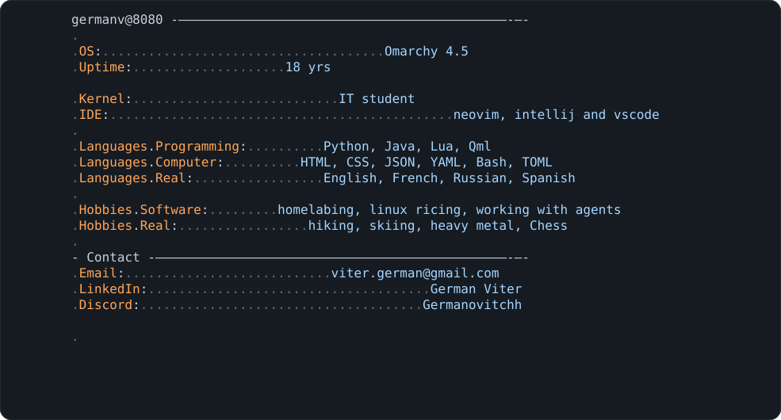

<h1 align="center">Hi 👋, I'm German Viter</h1>
<h3 align="center">Software engineering student (DEC in IT) in Montréal, looking for a summer 2027 internship</h3>
 

  <picture>
    
  </picture>
   
  
  

---
 
## Projects

<table>
  <tr>
    <td width="50%" valign="top">
      <h3><a href="https://github.com/GermanViter/spotify-esp32">🎵 spotify-esp32</a></h3>
      Shows the currently playing Spotify song on an OLED display driven by an ESP32. 
      <b>ESP32 · OLED · Spotify API · Python</b>
    </td>
    <td width="50%" valign="top">
      <h3><a href="https://github.com/GermanViter/snakeGame">🐍 snakeGame</a></h3>
      A snake game inspired by Google's version. 
      <b>Python</b>
    </td>
  </tr>
  <tr>
    <td width="50%" valign="top">
      <h3><a href="https://github.com/GermanViter/linux_dots">🐧 linux_dots</a></h3>
      My config files for Hyprland and the Caelestia shell (on the <code>caelestia_dots</code> branch). 
      <b>Hyprland · Caelestia · Lua · Shell</b>
    </td>
    <td width="50%" valign="top">
      <h3><a href="https://github.com/GermanViter/omarchy_dots">⚙️ omarchy_dots</a></h3>
      My own configuration for Omarchy. 
      <b>Omarchy · Linux</b>
    </td>
  </tr>
</table>

---
 
## My skills
 
<table>
  <tr>
    <td valign="middle">
      
    </td>
    <td valign="middle" align="center">
      
    </td>
  </tr>
</table>

 
## My stats

  

